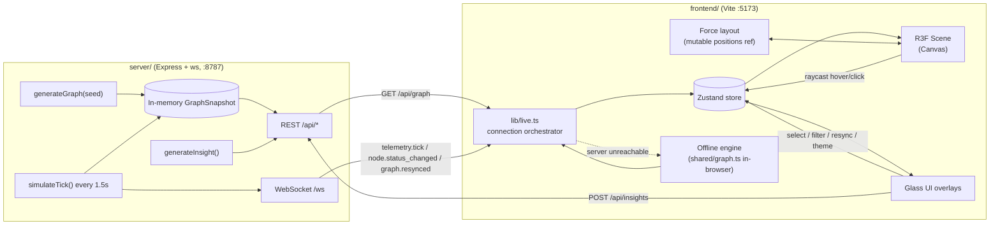

# Lumora AI — Architecture

Lumora AI renders a live system topology (microservices, data stores, queues, AI workers) as a glowing,
force-directed 3D "constellation". This document covers the high-level data flow, the React component
hierarchy and the Three.js scene graph.

## 1. Repository layout

```
Lumora-AI/
├── docs/                    # Design specs (this package)
│   ├── architecture.md
│   ├── api_spec.md
│   └── ui_ux_wireframe.md
├── shared/                  # Isomorphic TypeScript (no deps) used by server AND frontend
│   └── graph.ts             # Domain types, seeded graph generator, telemetry simulator, insight engine
├── server/                  # Light mock API (Express + ws), run with Node 24 native TS type-stripping
│   └── index.ts
└── frontend/                # Vite + React 19 + Tailwind v4 + React Three Fiber
    └── src/
        ├── App.tsx
        ├── store.ts         # Zustand store (graph, telemetry, selection, filters, settings)
        ├── lib/             # API client, live-connection orchestration, themes, formatting
        ├── scene/           # R3F components (canvas, nodes, edges, physics, camera rig)
        └── ui/              # Glassmorphism overlays (top bar, control dock, inspector, legend)
```

`shared/graph.ts` is the single source of truth for the data model. Because the frontend can fall back
to running the same generator/simulator in the browser, the dashboard is fully demo-able with **no
backend** (e.g. on a static host or flaky hackathon Wi-Fi).

## 2. High-level data flow



### Lifecycle

1. **Boot** — `lib/live.ts` calls `GET /api/graph` (proxied by Vite to `:8787`). On success it opens
   `ws://…/ws`; on failure it switches to *offline mode* and runs `generateGraph()` + a
   `setInterval(simulateTick)` loop locally. The top bar shows `LIVE` vs `SIMULATED`.
2. **Telemetry** — every tick (default 1500 ms) node metrics/status and edge throughput are merged into
   the store. Per-node metric history (last 40 samples) feeds inspector sparklines.
3. **Interaction** — R3F pointer events (raycasting against node meshes) set `hoveredId` /
   `selectedId`. Selection triggers the camera rig fly-to and opens the inspector drawer.
4. **AI insight** — the inspector calls `POST /api/insights {nodeId}`; the server runs the heuristic
   insight engine against the node, its neighbours and their live metrics. Offline mode runs the same
   function in the browser.
5. **Re-sync** — `POST /api/resync` regenerates statuses/metrics and broadcasts `graph.resynced` to
   every connected client.

### State ownership

| Data | Owner | Why |
| --- | --- | --- |
| Graph snapshot, telemetry, history | Zustand store | Shared by scene + UI, low frequency (≈1 Hz) |
| Selection, hover, filters, settings | Zustand store | Drives both scene highlighting and UI |
| Node positions / velocities | `scene/layout.ts` module (`Map<id, Body>`) | Updated 60×/s by the physics loop — kept out of React state to avoid re-renders |
| Camera animation target | `<CameraRig>` local ref | Purely presentational |
| Label DOM elements | `scene/labels.ts` registry | Written by `<LabelProjector>` every frame |

## 3. Component hierarchy

```mermaid
flowchart TD
    App --> TopBar
    App --> Scene
    App --> ControlDock
    App --> InspectorDrawer
    App --> Legend
    App --> HoverTooltip
    App --> ThreatOverlay["ThreatOverlay (critical edge glow)"]
    App --> LogViewer["LogViewer (logs / traces / runbook modal)"]
    TopBar --> NotificationBell["NotificationBell → AlertCard × N"]
    App --> NodeLabels["NodeLabels (DOM label layer)"]

    Scene["Scene (R3F &lt;Canvas&gt;)"] --> Backdrop["Backdrop (Stars, fog, lights)"]
    Scene --> Constellation
    Scene --> CameraRig["CameraRig (OrbitControls + fly-to)"]
    Scene --> LabelProjector["LabelProjector (projects label DOM nodes each frame)"]
    Scene --> Effects["Effects (Bloom, Vignette)"]

    Constellation --> ForceLayout["useForceLayout (physics hook)"]
    Constellation --> NodeMesh["NodeMesh × N"]
    Constellation --> Edges["Edges (pulsing LineSegments shader)"]
    Constellation --> FlowParticles["FlowParticles (Points)"]

    ControlDock --> FilterGroup["Type / status filters"]
    ControlDock --> PhysicsControls["Physics + gravity"]
    ControlDock --> ViewControls["Labels, auto-rotate, flow, threat FX, theme, icon style"]
    ControlDock --> ResyncButton

    InspectorDrawer --> RiskGauge["RiskGauge (lib/risk.ts)"]
    InspectorDrawer --> SourceLinks["SourceLinks (lib/links.ts)"]
    InspectorDrawer --> MetricCard["MetricCard + Sparkline × 5"]
    InspectorDrawer --> ConnectionList
    InspectorDrawer --> InsightPanel["AI Insight panel"]
```



## 4. Three.js scene graph

```
Scene
├── Color / Fog                         (theme background, depth fade)
├── AmbientLight, PointLight ×2         (rim lighting for MeshStandardMaterial)
├── Stars (drei)                        (≈4k background points, slow drift)
├── Group "constellation"
│   ├── Group "nodes"
│   │   └── Group node:<id>  × N        (position written by physics each frame)
│   │       ├── Mesh core               SphereGeometry, MeshStandardMaterial emissive=statusColor, toneMapped=false (→ bloom)
│   │       ├── Mesh halo               SphereGeometry (larger), additive MeshBasicMaterial, pulsing scale
│   │       └── Mesh ring               RingGeometry, shown on hover/selection, billboarded
│   ├── LineSegments "edges"            BufferGeometry: position, aProgress (0→1 along edge), aColor, aVisible
│   │                                   ShaderMaterial: travelling pulse = fract(aProgress - uTime*speed), additive blending
│   └── Points "flow"                   K particles per edge, positions lerped source→target each frame
├── PerspectiveCamera (fov 50)
└── EffectComposer
    ├── Bloom (mipmap blur, luminanceThreshold 0.15)
    └── Vignette
```

### Rendering notes

- **Glow** comes from emissive colours with `toneMapped: false` pushed above 1.0 intensity, picked up by
  the `Bloom` pass. Status changes lerp the emissive colour so transitions look smooth.
- **Edges** are a single `LineSegments` draw call. Positions are rewritten every frame from the physics
  positions map; `aVisible` is rewritten only when filters change.
- **Labels** are plain DOM elements rendered by `<NodeLabels>` outside the canvas and positioned by
  `<LabelProjector>` (`Vector3.project`) each frame. They keep a constant pixel size, fade with depth
  and avoid one React root per label.
- **Raycasting** uses R3F's built-in pointer-event system on the node core meshes
  (`onPointerOver/Out/onClick`), with `onPointerMissed` on the canvas to clear the selection.
- **Camera** — `OrbitControls` with damping, `minDistance 8`, `maxDistance 140`, polar clamping.
  `CameraRig` lerps both `controls.target` and `camera.position` towards the selected node (offset along
  the current view direction) and releases control as soon as the user starts dragging.
- **Physics** — O(N²) repulsion (fine for N < 200), Hooke springs on edges, a configurable
  gravity pull toward each node's cluster centroid and the origin, velocity damping. Runs inside
  `useFrame`; disabling physics freezes positions in place.

## 5. Performance budget

| Item | Budget (demo laptop, 60 fps) |
| --- | --- |
| Nodes | ≤ 150 individual meshes |
| Edges | ≤ 400 in one draw call |
| Flow particles | ≤ 1,200 in one draw call |
| React re-renders | Only on telemetry tick (≈1.5 s), selection, filter changes |
| Post-processing | Bloom + vignette (single composer) |
